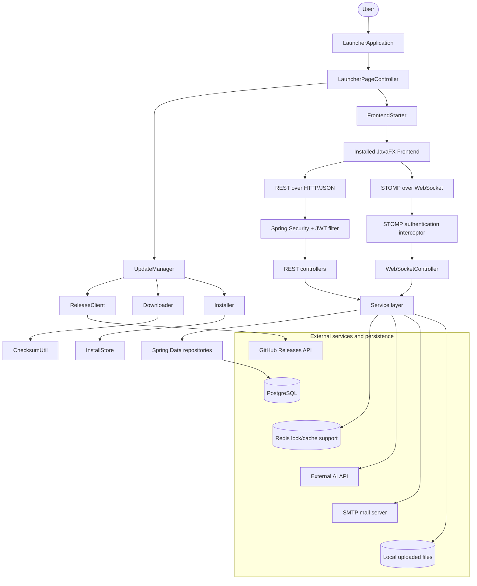
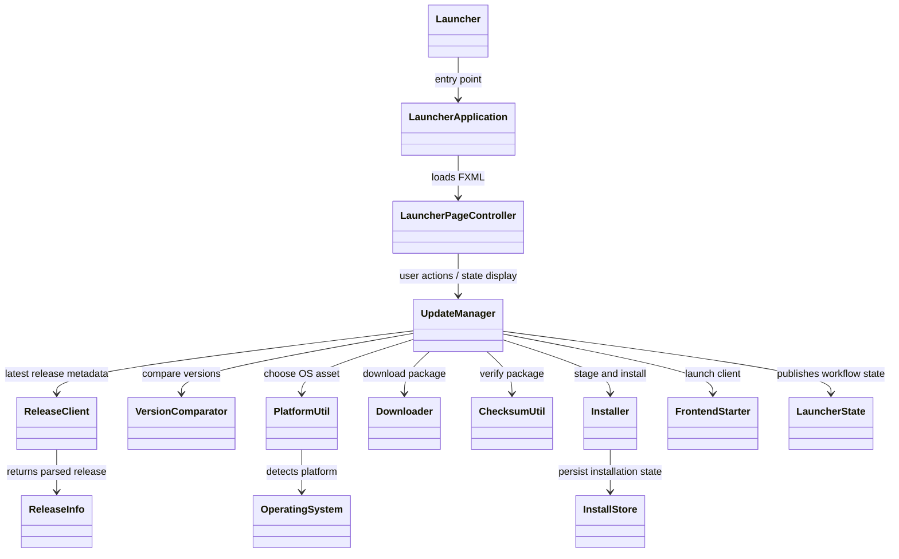
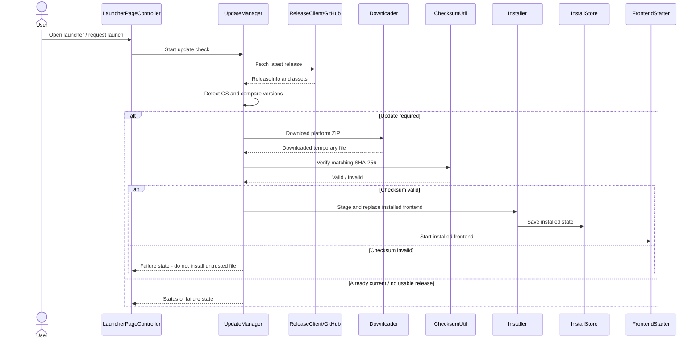
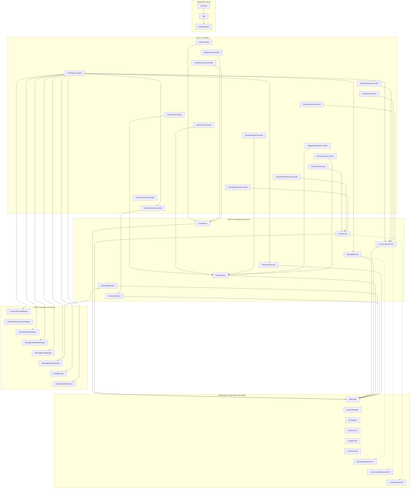
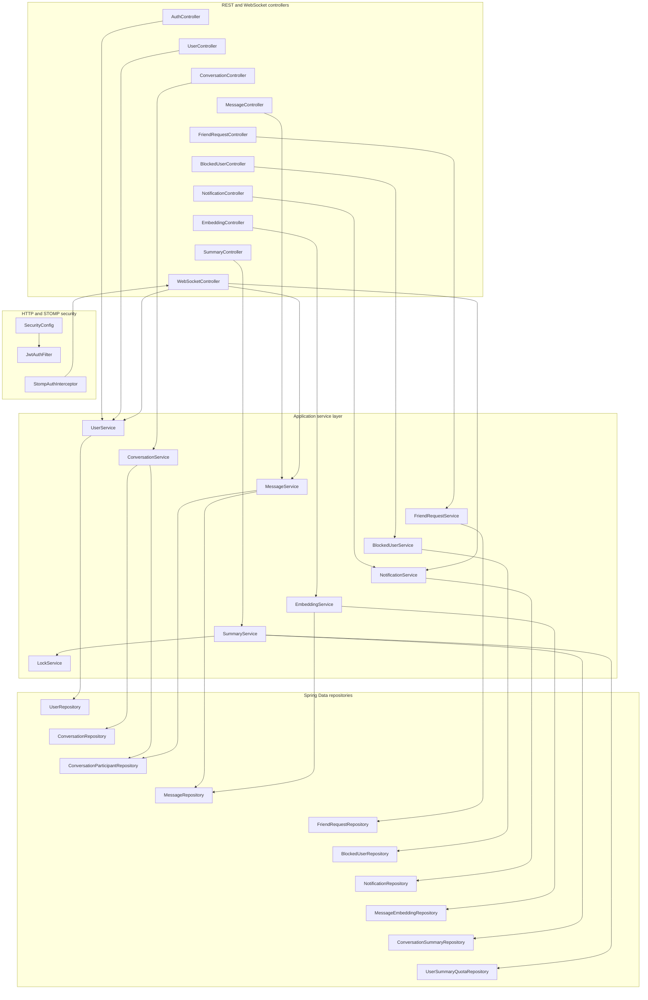
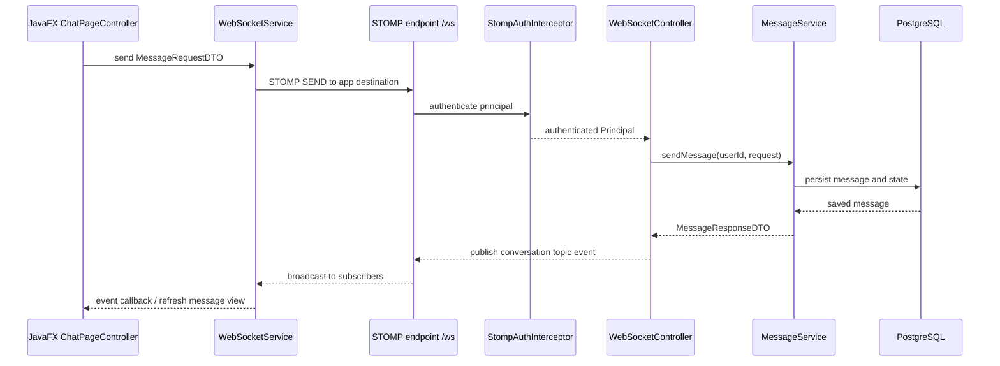
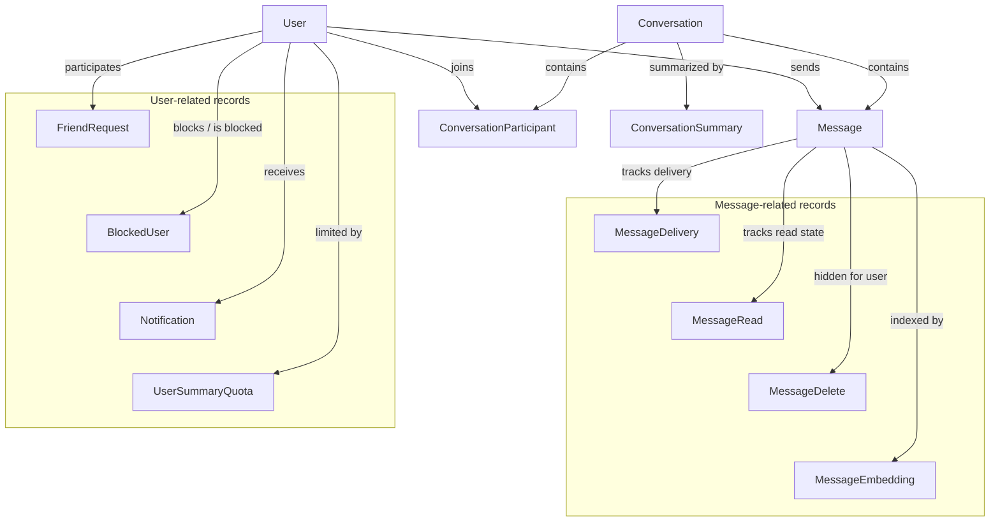
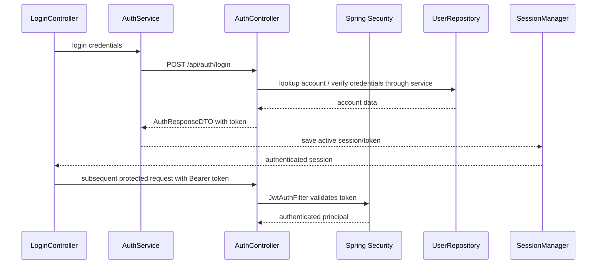
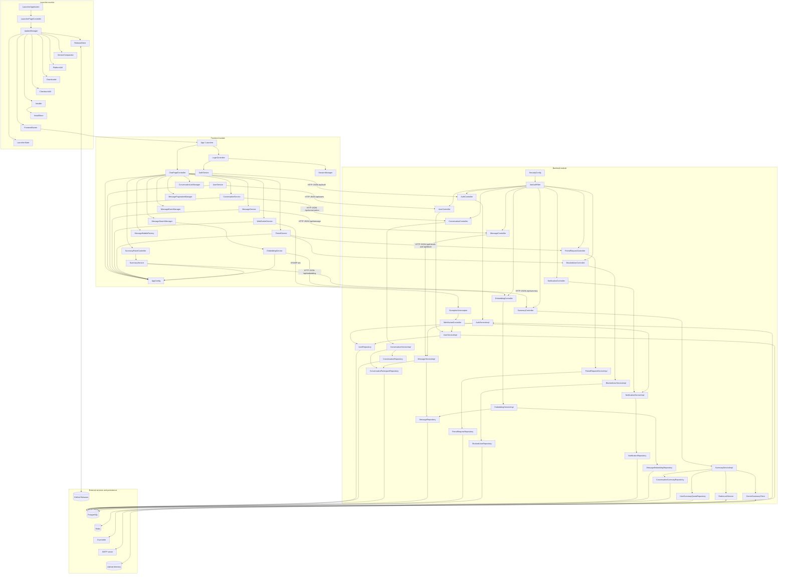

# BP-Chat — Desktop Messaging Application

BP-Chat is a desktop messaging application built around a JavaFX client, a dedicated JavaFX launcher/updater, and a Spring Boot REST/WebSocket backend. The project is organized as three separately buildable applications that cooperate at runtime:

- **Launcher** — checks GitHub Releases for the latest published build, selects the correct platform asset, downloads it, verifies its SHA-256 checksum, installs the new frontend directory, and starts the installed client.
- **Frontend** — a JavaFX desktop application for account access, one-to-one and group conversations, messaging, friend requests, blocking, notifications, profile management, themes, semantic message search, and AI-assisted conversation summaries.
- **Backend** — a Spring Boot service responsible for authentication, user and conversation rules, persistence in PostgreSQL, message delivery/read state, WebSocket events, notifications, embeddings/search, summaries, file uploads, and password-reset email.

This README documents the repository as it exists in source. Exact behavior is enforced by the implementation; where configuration is environment-specific, examples use placeholders rather than embedding credentials. The API reference is based on the controller mappings and DTO/service signatures in this repository. It is not a substitute for tests against a running instance.

---

## Contents

1. [Features](#features)
2. [Architecture](#architecture)
3. [Repository layout](#repository-layout)
4. [Prerequisites](#prerequisites)
5. [Initial setup](#initial-setup)
6. [Backend configuration reference](#backend-configuration-reference)
7. [Run and build](#run-and-build)
8. [Installing as a tester](#installing-as-a-tester)
9. [Launcher](#launcher)
10. [Frontend](#frontend)
11. [Backend internals](#backend-internals)
12. [REST API reference](#rest-api-reference)
13. [WebSocket/STOMP API](#websocketstomp-api)
14. [Persistence model](#persistence-model)
15. [End-to-end request flows](#end-to-end-request-flows)
16. [Troubleshooting](#troubleshooting)
17. [Security and deployment notes](#security-and-deployment-notes)

---

## Viewing the diagrams

The Mermaid source is kept in this README so diagrams remain editable as text and render automatically on GitHub. 

---

## Features

### Accounts and security
- Account registration and login.
- JWT-based authentication for protected REST requests.
- Profile editing, profile-picture upload, and password change.
- Forgot-password and reset-password endpoints, backed by mail configuration and reset tokens.
- Online/offline presence events.

### Conversations and messaging
- One-to-one conversation creation and group conversation management.
- Conversation listing and participant information.
- Send, page through, edit, and delete messages for yourself or for everyone.
- Message delivery and read-state tracking through STOMP/WebSocket messages.
- Group membership management, including add/remove/leave, promotion/demotion, group metadata, and invitation permissions.
- Message deletion records, read records, and delivery records represented in the backend persistence model.

### Social features
- Send, accept, reject, list, and remove friend relationships.
- Suggested friends.
- Block and unblock users and list blocked accounts.
- In-app notifications and mark-read operations.

### Search and AI-assisted features
- Semantic message search backed by message embeddings and an external embedding provider.
- Conversation summaries backed by a generative AI client.
- Summary persistence and per-user summary quota tracking.
- Background embedding sweep/scheduling support.

### Desktop experience
- JavaFX UI built from FXML and CSS.
- Separate launcher with release discovery, download, checksum verification, installation, and frontend startup.
- Local theme preferences, avatar/image caching, popup/scene utilities, asynchronous task execution, and message pagination/search managers.

---

## Architecture

### System-level architecture



### Runtime boundaries

| Component | Responsibility | Main integration boundary |
|---|---|---|
| Launcher | Updates and starts the desktop client | GitHub Releases API, local filesystem/process |
| Frontend | UI, local session/theme state, HTTP and WebSocket client | REST endpoints under `/api`, WebSocket endpoint `/ws` |
| Backend | Authentication, authorization, domain rules, persistence, integrations | PostgreSQL, Redis, SMTP, AI provider, upload directory |

The launcher does **not** replace the backend and does not create the database. It downloads/installs the frontend package. The frontend's `settings.properties` selects the backend base URL. The backend's `application.properties` selects database, token, mail, file, and AI settings.

### Typical request lifecycle

1. A user action in a JavaFX controller calls a frontend service, such as `MessageService` or `ConversationService`.
2. The service serializes a DTO to JSON and sends an HTTP request using the configured API base URL. Authenticated calls include the JWT held by the frontend session utilities.
3. Spring Security authenticates the request and places the authenticated `User` principal in the security context.
4. A REST controller validates/extracts path, query, multipart, or body input and delegates business work to a service.
5. The service checks permissions and domain rules, then uses Spring Data repositories to read or write PostgreSQL rows.
6. The controller returns a DTO or an empty success response. The frontend updates its view or reloads the affected data.
7. Real-time message/presence/read/delivery operations use STOMP over WebSocket instead of polling for every event.

---

## Repository layout

```text
ChatApp/
├── launcher/                         JavaFX launcher/updater (Maven)
│   └── src/main/
│       ├── java/com/chatapplauncher/launcher/
│       │   ├── Launcher.java
│       │   ├── LauncherApplication.java
│       │   ├── config/               LauncherConfig
│       │   ├── controllers/          LauncherPageController
│       │   ├── manager/              UpdateManager
│       │   ├── model/                State, OS, release metadata
│       │   ├── service/              Download/install/release/start services
│       │   └── util/                 Checksums, platform and version utilities
│       └── resources/com/chatapplauncher/launcher/
│           ├── launcher-panel.fxml
│           └── styles/main.css
├── frontend/frontend/                JavaFX desktop client (Maven)
│   └── src/main/
│       ├── java/com/chatappfrontend/frontend/
│       │   ├── controller/           Screen and popup controllers
│       │   ├── service/              REST/WebSocket client services
│       │   ├── manager/              Chat state, pagination, events, panels
│       │   ├── model/                API DTO mirrors and UI models
│       │   ├── cell/                 JavaFX list-cell renderers
│       │   ├── factory/              Message bubble construction
│       │   └── util/                  Session, config, cache, scene and UI helpers
│       └── resources/
│           └── settings.properties    Frontend API base URL and visual defaults
├── backend/chatAppBackend/            Spring Boot backend (Maven)
│   └── src/main/
│       ├── java/com/chatappbackend/backend/
│       │   ├── controller/            REST and WebSocket controllers
│       │   ├── service/               Business rules and integrations
│       │   ├── repository/             Persistence queries
│       │   ├── entity/                 JPA entities and embedded IDs
│       │   ├── dto/                    Request/response/event DTOs
│       │   ├── config/                 Security, WebSocket, mail, MVC, scheduling
│       │   └── exception/               Domain/integration exceptions
│       └── resources/application.properties
├── .github/workflows/
│   └── release.yml                     GitHub Actions: builds the per-OS packages and publishes a release on version tags
├── compose.yaml                        Redis service for local development
└── .gitignore
```

> `target/`, `.idea/`, generated distributions, and local uploads are build/developer artifacts, not source that should normally be committed. The repository archive supplied for documentation includes generated/build and Git metadata; the layout above describes the source structure rather than every archived file.

---

## Prerequisites

Install the following before building from source:

| Dependency | Purpose | Check command |
|---|---|---|
| JDK 25 | Compile and run the Java projects as configured in their Maven files | `java -version` |
| Maven 3.9+ (or project wrapper where present) | Build backend, frontend, and launcher | `mvn -version` |
| PostgreSQL | Backend relational database | `psql --version` |
| Docker Engine + Compose plugin (optional but recommended) | Run Redis using `compose.yaml` | `docker compose version` |
| Git | Clone/pull the repository and inspect release history | `git --version` |
| GitHub account/repository access | Publish release assets used by launcher updates | Browser / GitHub CLI optional |
| SMTP account (optional for email workflows) | Password reset emails | Provider-specific |
| AI provider API key (for AI features) | Embeddings and summaries | Provider console |

The backend POM sets Java 25. The frontend and launcher POMs also configure compiler release 25, while JavaFX dependencies are version 21.0.6. Use a JDK that satisfies the configured compiler release; JavaFX libraries do not mean the project can be compiled with an older JDK.

### Database setup

Create a database and a dedicated local user. Choose your own password; do not use a password copied from an example or an old local configuration.

```sql
CREATE USER bpchat_user WITH PASSWORD 'replace_with_a_strong_local_password';
CREATE DATABASE chatapp OWNER bpchat_user;
```

If the database already exists, verify the owner and grants instead of creating a duplicate. The datasource URL in the example configuration below assumes PostgreSQL listens on `localhost:5432` and the database is named `chatapp`.

The backend currently uses `spring.jpa.hibernate.ddl-auto=validate`. That means Hibernate validates the mapped schema at startup; it does **not** create or update tables for you. The database must already have a schema compatible with the entities. Use the project's established schema/migration process or a known-good development database. Do not switch to `create`/`update` casually on a database containing data.

### Redis setup

At the repository root, the supplied `compose.yaml` starts Redis 7 on loopback only:

```bash
docker compose up -d redis
docker compose ps
docker compose logs redis
```

Redis is used by the backend's lock-service abstraction. Check the actual `RedisLockService` and Redis configuration before assuming every application feature requires Redis; if the service is unavailable, operations that rely on it may fail or be unable to coordinate safely.

---

## Initial setup

### 1. Obtain the source

Clone the repository using your own repository URL, then enter its root:

```bash
git clone <YOUR_REPOSITORY_URL> ChatApp
cd ChatApp
```

If you already have the repository locally, use `git pull` on the intended branch rather than cloning a second copy. Avoid building from an archive that contains stale `target/` output when troubleshooting compilation.

### 2. Create backend configuration

Open `backend/chatAppBackend/src/main/resources/`. Create `application.properties` if it is absent. Keep a private local copy and do not commit real secrets. The backend reads this file through Spring Boot's standard configuration mechanism.

A safer local template is shown below. Replace each placeholder with a value from your own local setup. Environment-variable placeholders allow the same source to run on another machine without editing committed configuration.

```properties
spring.application.name=chatAppBackend

# PostgreSQL connection
spring.datasource.url=${DB_URL:jdbc:postgresql://localhost:5432/chatapp}
spring.datasource.username=${DB_USERNAME:bpchat_user}
spring.datasource.password=${DB_PASSWORD}
spring.datasource.driver-class-name=org.postgresql.Driver

# Existing schema is validated at startup; this does not create tables.
spring.jpa.hibernate.ddl-auto=validate
spring.jpa.show-sql=false

# JWT: use a cryptographically random secret appropriate for the JJWT signing algorithm.
# Keep this stable between restarts/environments that need to validate existing tokens.
jwt.secret=${JWT_SECRET}
jwt.expiration=${JWT_EXPIRATION_MS:604800000}

server.port=${SERVER_PORT:8080}

# SMTP: configure only if password-reset email is enabled/used.
spring.mail.host=${MAIL_HOST:smtp.gmail.com}
spring.mail.port=${MAIL_PORT:587}
spring.mail.username=${MAIL_USERNAME:}
spring.mail.password=${MAIL_PASSWORD:}
spring.mail.properties.mail.smtp.auth=true
spring.mail.properties.mail.smtp.starttls.enable=true
spring.mail.properties.mail.smtp.starttls.required=true
spring.mail.enabled=${MAIL_ENABLED:false}

# File storage: choose a writable directory on this machine.
file.upload-dir=${UPLOAD_DIR:./uploads/}
spring.web.resources.static-locations=file:./uploads/
spring.web.resources.add-mappings=true

# AI integration: supply the key used by the configured Gemini/embedding integration.
ai.api.key=${AI_API_KEY:}
```

**Important configuration notes:**

- `DB_URL`, `DB_USERNAME`, and `DB_PASSWORD` must match a reachable PostgreSQL database and user. `localhost` means the machine/container running the backend, not necessarily the machine running the desktop UI.
- `JWT_SECRET` must be a strong secret and must match across backend instances that need to accept the same tokens. Changing it invalidates existing tokens. Do not use the placeholder text literally.
- `JWT_EXPIRATION_MS` is in milliseconds. `604800000` is seven days.
- `MAIL_USERNAME` and `MAIL_PASSWORD` are SMTP credentials. For Gmail, use an App Password when applicable, not the normal account password. Leave mail disabled until configured if you are only testing non-email features.
- `UPLOAD_DIR` must be writable by the backend process. Ensure backups and deployment permissions account for user-uploaded files. Do not expose the whole filesystem.
- `AI_API_KEY` is a secret. The repository uses an AI API key property; verify provider configuration and model availability before expecting semantic search or summaries to work.
- Spring Boot supports environment-variable substitution in `.properties`. For a one-off local run, you can export variables in the shell before launching Maven. Never paste real values into issue reports.
- The template is intentionally safer than the checked-in example: it disables SMTP by default, disables SQL logging by default, and uses a relative upload directory. Confirm the application's runtime behavior after changing paths or mail settings.

Example environment setup in Bash (values are illustrative; replace them):

```bash
export DB_URL='jdbc:postgresql://localhost:5432/chatapp'
export DB_USERNAME='bpchat_user'
export DB_PASSWORD='your_local_database_password'
export JWT_SECRET='replace_with_a_long_random_signing_secret'
export MAIL_ENABLED='false'
export UPLOAD_DIR="$PWD/backend/uploads/"
# Only if you have configured an AI provider key:
export AI_API_KEY='your_provider_key'
```

Generate a strong random secret with a trusted password manager or cryptographic generator. Do not commit a `.env` file unless the repository explicitly ignores it and your team has a secure secret-management policy.

### 3. Verify the frontend settings file

The JavaFX client loads `/settings.properties` from its classpath using `AppConfig`. The file is located at:

`frontend/frontend/src/main/resources/settings.properties`

Its current keys are:

```properties
# Base backend URL only; do not append /api here.
api.base.url=http://localhost:8080

# Theme defaults consumed by the client where applicable.
glow.color=#00ff88
text.color=#ffffff
panel.color=#0f0f0f
panel.opacity=0.8
```

`api.base.url` is the backend origin, not the REST prefix. The services append their own paths such as `/api/auth`, `/api/message`, and `/api/conversation`. The WebSocket service derives a WebSocket URL from this base and appends `/ws`. For a remote server, update the base URL to the server's reachable HTTPS origin; configure TLS and the server's WebSocket proxy support together. Do not use `localhost` in a distributed client unless the backend really runs on the same user's computer.

### 4. Prepare the database schema

Because `ddl-auto=validate`, the schema must exist before startup. Confirm that the schema is the one intended for this source version and includes the tables/columns mapped by the JPA entities. If the project has a database dump or migration scripts in a separate location, use those rather than hand-writing tables from memory. This source archive does not establish a canonical migration script, so do not assume a fresh empty database can start successfully without schema initialization.

### 5. Start Redis (if using the provided local setup)

```bash
docker compose up -d redis
```

### 6. Start the backend

```bash
cd backend/chatAppBackend
mvn spring-boot:run
```

The configured default port is `8080`. Keep this terminal open and confirm the startup logs show successful database validation and application startup. If Maven wrapper scripts are present in your checkout, `./mvnw spring-boot:run` may be used instead.

### 7. Start the frontend

In another terminal:

```bash
cd frontend/frontend
mvn clean javafx:run
```

The frontend uses `settings.properties` for the backend origin. Ensure the backend is reachable before trying to sign in. The frontend can also be packaged using the configured `app-image` Maven profile; see [Frontend packaging](#frontend-packaging).

### 8. Start the launcher

In another terminal:

```bash
cd launcher
mvn clean javafx:run
```

The launcher checks the configured GitHub repository's latest release and looks for the platform-specific assets. For a first-time launch, the release must contain the expected ZIP asset and corresponding `.sha256` file. If no valid release exists yet (see [Publishing a launcher-compatible release](#publishing-a-launcher-compatible-release)), a first launch reports that it could not reach the update server; start the frontend directly instead.

---

## Backend configuration reference

The backend configuration file is `backend/chatAppBackend/src/main/resources/application.properties`.

| Property / environment variable | Purpose | Required? | Notes |
|---|---|---:|---|
| `spring.application.name` | Spring application name | No | Used for identification/logging. |
| `spring.datasource.url` / `DB_URL` | JDBC URL | Yes | PostgreSQL URL, e.g. `jdbc:postgresql://localhost:5432/chatapp`. |
| `spring.datasource.username` / `DB_USERNAME` | Database login | Yes | Prefer a dedicated least-privilege user. |
| `spring.datasource.password` / `DB_PASSWORD` | Database password | Yes | Never commit the real value. |
| `spring.datasource.driver-class-name` | JDBC driver | No | `org.postgresql.Driver` is explicit in the current config. |
| `spring.jpa.hibernate.ddl-auto` | Schema handling | Yes, operationally | Current value is `validate`; schema must already match entities. |
| `spring.jpa.show-sql` | SQL logging | No | Useful for local debugging; avoid noisy/sensitive production logs. |
| `jwt.secret` / `JWT_SECRET` | JWT signing key | Yes | Strong random secret; changing it invalidates existing tokens. |
| `jwt.expiration` / `JWT_EXPIRATION_MS` | JWT lifetime in milliseconds | No | Current code/config default: `604800000` (7 days). |
| `server.port` / `SERVER_PORT` | HTTP server port | No | Defaults to `8080`. |
| `spring.mail.host` / `MAIL_HOST` | SMTP server | Needed for email | Gmail SMTP host is commonly `smtp.gmail.com`. |
| `spring.mail.port` / `MAIL_PORT` | SMTP port | Needed for email | Common STARTTLS port is `587`. |
| `spring.mail.username` / `MAIL_USERNAME` | SMTP account | Needed for email | Sender account. |
| `spring.mail.password` / `MAIL_PASSWORD` | SMTP credential | Needed for email | Use an app-specific password where the provider requires it. |
| `spring.mail.properties.mail.smtp.auth` | SMTP authentication | No | `true` in the existing configuration. |
| `spring.mail.properties.mail.smtp.starttls.enable` | STARTTLS | No | `true` in the existing configuration. |
| `spring.mail.properties.mail.smtp.starttls.required` | Require STARTTLS | No | `true` in the existing configuration. |
| `spring.mail.enabled` / `MAIL_ENABLED` | Mail feature switch | No | The current source config sets it to true; the safer local template defaults false. Confirm how the mail configuration consumes it. |
| `file.upload-dir` / `UPLOAD_DIR` | Filesystem upload destination | Yes for uploads | Must be writable and persistent. |
| `spring.web.resources.static-locations` | Static file location | Needed for served uploads | Must align with how stored upload URLs are constructed. |
| `spring.web.resources.add-mappings` | Static resource mappings | No | Enabled in the current config. |
| `ai.api.key` / `AI_API_KEY` | AI provider credential | Needed for AI features | Never publish the key. Confirm the configured provider and enabled models. |

### Frontend configuration reference

| Key | File | Purpose |
|---|---|---|
| `api.base.url` | `frontend/frontend/src/main/resources/settings.properties` | Backend origin used by HTTP services and converted to a WebSocket origin by `WebSocketService`. |
| `glow.color` | Same | Default accent/glow color. |
| `text.color` | Same | Default text color. |
| `panel.color` | Same | Default panel background color. |
| `panel.opacity` | Same | Default panel opacity. |

### Launcher configuration reference

The launcher configuration is currently defined as Java constants in `LauncherConfig`, not in a properties file.

| Constant | Current role |
|---|---|
| `REPO_OWNER`, `REPO_NAME` | GitHub repository used for release discovery. |
| `LATEST_RELEASE_URL` | GitHub API endpoint for latest release metadata. |
| `BASE_PATH` | Per-user install root: `~/.bpchat/app` (platform home directory). |
| `LIVE_PATH`, `NEW_PATH`, `OLD_PATH` | Active, staged, and previous frontend directories used during replacement. |
| `TEMP_DOWNLOAD` | Partial download path, `download.part`. |
| `MARKER_FILE_NAME` | Installation/update marker filename. |
| `ASSET_WINDOWS`, `ASSET_LINUX`, `ASSET_MAC` | Expected release ZIP asset names. |
| `CHECKSUM_SUFFIX` | Suffix appended to asset name for its checksum file. |

If the repository owner, repository name, or release asset naming changes, update the constants and the release workflow together.

---

## Run and build

### Backend

```bash
cd backend/chatAppBackend
mvn clean test
mvn spring-boot:run
```

Create a runnable package:

```bash
mvn clean package
```

### Frontend

```bash
cd frontend/frontend
mvn clean test
mvn javafx:run
```

The Maven profile `app-image` is configured for a platform-specific Java application image:

```bash
mvn clean package -Papp-image
```

`jpackage` output is platform-dependent: create and test the image on each target OS, and check the exact output under `target/dist/`. A Windows package should be built and tested on Windows, a macOS package on macOS, and a Linux package on Linux unless a separately validated cross-packaging approach is in place.

### Launcher

```bash
cd launcher
mvn clean test
mvn javafx:run
mvn clean package
```

The released launcher is a packaged application image with its own Java runtime, built with the `app-image` Maven profile (the same approach as the frontend):

```bash
cd launcher
./mvnw -Papp-image clean package
```

The result is in `launcher/target/dist/` (`BP-Chat-Launcher/` on Linux and Windows, `BP-Chat-Launcher.app` on macOS). Always test a packaged build, not only `javafx:run`: a packaged launcher runs in a different environment from one started by an IDE, and at least one startup problem only appeared in the packaged form.

### Running tests

The POMs include JUnit dependencies and backend test starter dependencies, but dependency presence is not evidence that every feature has automated coverage. Run the commands above and inspect test reports under `target/surefire-reports/`. Treat a successful compile as compile verification, not proof that authentication, updater rollback, file upload, AI quota, and WebSocket behavior all work correctly.

The GitHub Actions release workflow builds only the frontend (`./mvnw -Papp-image clean package` in `frontend/frontend`). Maven runs any frontend tests during that build, so a failing test fails the build and no release is published. There is currently no separate workflow that runs tests on every push or pull request, and the backend and launcher are not built in CI.

---

## Installing as a tester

This section is for people who only want to run BP-Chat. Developers who build from source follow [Initial setup](#initial-setup) instead.

**What you need first.** The packaged frontend connects to the backend address stored in its `settings.properties` (`localhost` by default), so the backend, PostgreSQL and Redis must be running on the same machine. Follow the backend steps in [Initial setup](#initial-setup) before starting the app.

**Steps**

1. Open the latest release on the project's GitHub **Releases** page and download only `bpchat-launcher-<os>.zip` for your operating system (`linux`, `windows` or `mac`). Ignore the other files and the automatic "Source code" archives: the launcher downloads the application itself.
2. Unzip it anywhere, for example on the desktop.
3. Start the launcher:
   - Linux: `BP-Chat-Launcher/bin/BP-Chat-Launcher`
   - Windows: `BP-Chat-Launcher/BP-Chat-Launcher.exe`
   - macOS: `BP-Chat-Launcher.app`
4. On the first start the launcher downloads and installs the application into `~/.bpchat/app` and then starts it. On later starts it checks for a newer release and updates automatically before opening the app.

**Security warnings.** The packages are not code-signed, so the operating system may warn you:

- **Windows:** SmartScreen may show "Windows protected your PC". Choose **More info**, then **Run anyway**.
- **macOS:** Gatekeeper may refuse to open the app. Control-click (or right-click) it, choose **Open**, and confirm; or allow it under **System Settings → Privacy & Security**. The macOS build runs on Apple Silicon Macs only.
- **Linux:** the GTK 3 libraries must be installed (standard on most desktop distributions). If an archive tool did not keep the executable permission, run `chmod +x BP-Chat-Launcher/bin/BP-Chat-Launcher`.

**Where files go.** Everything the launcher and the app store is under `.bpchat` in your home folder (`~/.bpchat` on Linux and macOS, `C:\Users\<name>\.bpchat` on Windows): the installed application in `app/`, your theme and saved email history, and `frontend.log`. To uninstall, delete the launcher folder and the `.bpchat` folder.

**If the app does not open,** the launcher shows a failure message. The application's own output is in `~/.bpchat/frontend.log` (overwritten on every start); send that file when reporting a problem. See also [Troubleshooting](#troubleshooting).

# Launcher

## What the launcher does

The launcher is a standalone JavaFX application. It is intentionally separate from the chat client so users can receive a new frontend build without manually replacing application files. The current implementation is configured for GitHub Releases and expects these asset names:

- `bpchat-windows.zip` and `bpchat-windows.zip.sha256`
- `bpchat-linux.zip` and `bpchat-linux.zip.sha256`
- `bpchat-mac.zip` and `bpchat-mac.zip.sha256`

Each platform has two assets: the ZIP, which contains the application itself (the frontend application image with its own Java runtime), and a small text file with the ZIP's SHA-256 checksum, which the launcher uses to detect a corrupted download before installing. The launcher only needs the pair for its own operating system and ignores the others, so a release carries six update assets in total. It also carries three launcher downloads, `bpchat-launcher-linux.zip`, `bpchat-launcher-windows.zip` and `bpchat-launcher-mac.zip`, which are what a new user downloads first; the launcher itself never reads them, and they have no checksum file because the launcher cannot update itself. A release with a ZIP but no matching checksum file is not installable.

The launcher reads the checksum file as text and uses only its first whitespace-separated word, which must be 64 hexadecimal characters. The standard `sha256sum` / `shasum -a 256` output (hash, then file name) is therefore accepted. `ChecksumUtil` computes the SHA-256 of the downloaded file, and the two values are compared before anything is installed.

The release's tag must have the form `vMAJOR.MINOR.PATCH` (for example `v1.2.3`; the `v` is optional). `VersionComparator` rejects any other format, including suffixes such as `-beta` or `-test`, and the launcher then treats the release as unusable. Because the GitHub API's "latest release" is the newest published release, a release with an invalid tag stops new installs from finding a usable release until a valid one is published.

When the launcher starts the installed frontend (`FrontendStarter`) it does four things beyond running the executable:

- It writes everything the frontend prints, including errors, to `~/.bpchat/frontend.log`, which is overwritten on each start.
- It removes JVM-configuration variables from the environment the frontend inherits (`JAVA_TOOL_OPTIONS`, `JDK_JAVA_OPTIONS`, `_JAVA_OPTIONS`, `CLASSPATH`, `JAVA_MAIN_CLASS_*`, and any name containing `JPACKAGE`). The frontend ships its own runtime, and when it was started from the packaged launcher without this cleanup it printed Java's usage text and exited immediately. The exact variable responsible was not isolated.
- It marks the main executable as executable, because ZIP extraction does not preserve permissions.
- It waits up to two seconds. If the frontend has already exited by then, the launcher shows a failure containing the exit code and the log path instead of closing silently.

## Launcher classes

| Class | Responsibility | Why it exists |
|---|---|---|
| `Launcher` | JavaFX entry/compatibility class for launcher startup. | Keeps the declared launcher entry point separate from UI/controller code. |
| `LauncherApplication` | JavaFX `Application`; loads the launcher FXML, creates the stage, and starts the desktop UI. | Owns application lifecycle and primary window creation. |
| `config.LauncherConfig` | Central constants for GitHub release URL, asset names, install paths, marker, and app name. | Prevents update paths and naming rules from being scattered across classes. |
| `controllers.LauncherPageController` | Binds FXML controls to launcher actions and displays progress/status/failure state. | Keeps UI events and presentation separate from update mechanics. |
| `manager.UpdateManager` | Coordinates the update workflow: release lookup, version decision, download, checksum, install, and launch/update state. | Provides one orchestration point instead of placing the whole workflow in the controller. |
| `model.LauncherState` | Represents launcher states such as checking, downloading, installing, and failure. | Makes asynchronous progress and failure states explicit. |
| `model.OperatingSystem` | Represents supported OS targets. | Provides a stable platform identifier for asset selection. |
| `model.ReleaseInfo` | Holds parsed release metadata, including version and asset information. | Separates GitHub API response parsing from update decisions. |
| `service.ReleaseClient` | Calls GitHub's latest-release API, selects the asset pair for the current OS, downloads the `.sha256` text and parses the expected hash. | Encapsulates the external release API. |
| `service.Downloader` | Downloads a release asset to a temporary/partial file. | Isolates transfer and progress behavior from installation. |
| `service.Installer` | Unpacks/stages the downloaded frontend and coordinates replacement of the installed version. | Handles filesystem changes as a distinct operation. |
| `service.InstallStore` | Manages the local installed-version/installation metadata used by launcher logic. | Keeps install-state persistence out of the controller. |
| `service.FrontendStarter` | Starts the installed frontend process, logs its output to `~/.bpchat/frontend.log`, strips inherited JVM settings from its environment, and reports a crash within the first two seconds. | Separates process startup and OS-specific invocation from update logic. |
| `util.ChecksumUtil` | Calculates/checks SHA-256 checksums. | Detects corrupted or mismatched downloaded packages before installation. |
| `util.PlatformUtil` | Detects the host operating system and platform-specific details. | Avoids scattering OS detection throughout the update pipeline. |
| `util.VersionComparator` | Compares current and remote release versions. | Makes update/no-update decisions consistent. |

### Launcher class relationship diagram



### Update lifecycle



### Publishing a launcher-compatible release

Releases are built and published by the GitHub Actions workflow `.github/workflows/release.yml`. It runs when a tag starting with `v` is pushed. Use a valid version tag (see [What the launcher does](#what-the-launcher-does)):

```bash
git tag v1.2.3
git push origin v1.2.3
```

Commit and push the code first: the tag must point at a commit that contains the workflow and the changes you want to ship.

The workflow has two jobs:

1. **Build (once per OS, in parallel).** On GitHub-hosted Linux, Windows and macOS machines it checks out the repository, installs JDK 25, runs `./mvnw -Papp-image clean package` in `frontend/frontend`, zips the generated application image, and computes the SHA-256 checksum of the finished ZIP. It then does the same packaging for the launcher (`./mvnw -Papp-image clean package` in `launcher`, zipped as `bpchat-launcher-<os>.zip`). The three files for that OS are copied into one flat folder and uploaded together as a workflow artifact.
2. **Release.** It runs only if all three builds succeeded. It downloads the nine files (three per OS) and creates a GitHub Release for the tag with all of them attached. If any build fails, no release is created, so a partial release is never published.

Each ZIP is laid out to match the paths in `OperatingSystem`, which the launcher resolves relative to the extracted install folder:

| OS | ZIP name | ZIP root contains | Executable path used by the launcher | Tool |
|---|---|---|---|---|
| Linux | `bpchat-linux.zip` | contents of `target/dist/BP-Chat` (`bin/`, `lib/`) | `bin/BP-Chat` | `zip` |
| Windows | `bpchat-windows.zip` | contents of `target/dist/BP-Chat` (`BP-Chat.exe`, `app/`, `runtime/`) | `BP-Chat.exe` | `7z` |
| macOS | `bpchat-mac.zip` | `BP-Chat.app` | `BP-Chat.app/Contents/MacOS/BP-Chat` | `ditto` |

The checksum is created after the ZIP, because any later change to the ZIP changes its hash. The macOS archive is created with `ditto` instead of `zip` so the application bundle's structure is preserved.

The launcher ZIPs are for people to unzip by hand, so unlike the update ZIPs they keep their top-level folder:

| OS | ZIP name | ZIP root contains | Tool |
|---|---|---|---|
| Linux | `bpchat-launcher-linux.zip` | the folder `BP-Chat-Launcher` (`bin/`, `lib/`) | `zip` |
| Windows | `bpchat-launcher-windows.zip` | the folder `BP-Chat-Launcher` (`BP-Chat-Launcher.exe`, `app/`, `runtime/`) | `7z` |
| macOS | `bpchat-launcher-mac.zip` | `BP-Chat-Launcher.app` | `ditto` |

The upload step collects the three files into a single folder first. If files from different folders were uploaded directly, the artifact would keep the folder structure and the release step would try to attach folders instead of files.

#### Known limitations

- The macOS build is made on GitHub's Apple Silicon runner, so it runs on Apple Silicon Macs only. The Linux build is for x86-64.
- Neither the launcher nor the frontend is code-signed or notarized, so Windows SmartScreen and macOS Gatekeeper warn on first start.
- The launcher does not update itself. A change to the launcher reaches users only when they download a new launcher ZIP.
- The Linux build is made on the runner's Ubuntu and bundles its own Java runtime. It needs a compatible C library on the user's system (the same or a newer version than the build machine's) and the GTK 3 libraries that JavaFX uses.
- `Installer` extracts ZIPs with `ZipInputStream`, which does not restore file permissions or symbolic links, and `FrontendStarter` marks only the main executable as executable. A fresh install through the packaged launcher has been verified on Linux. Windows, macOS, and update-over-an-existing-install should be tested with a real release before being treated as reliable.
- The packaged frontend contains `settings.properties`. A release built with `api.base.url` pointing at `localhost` only works on machines where the backend runs locally.

Before relying on a release, test a first install and an update over an existing install on each supported OS. Also test interrupted downloads, a bad checksum, missing assets, and recovery if installation is interrupted.

The launcher is only as reliable as the release asset structure and the atomicity/recovery behavior of the installer. Do not call an update workflow production-ready until it has been tested on each supported operating system with a real release.

---

# Frontend

## Frontend responsibilities

The frontend is a JavaFX desktop application. FXML defines view structure, CSS defines appearance, controllers handle user interaction, service classes communicate with the backend, manager classes coordinate cross-controller chat state, and DTO/model classes represent API payloads. The app reads `settings.properties` through `AppConfig`; theme preference persistence is handled separately by `ThemeStorage` and the theme manager utilities.

## Frontend class catalogue

### Application and controllers

| Class | Responsibility |
|---|---|
| `App` | Main JavaFX application lifecycle. |
| `Launcher` | Declared frontend entry point used by Maven/jpackage configuration. |
| `controller.LoginController` | Login screen interaction and authentication handoff. |
| `controller.RegistrationController` | Registration form and registration request. |
| `controller.ForgotPasswordController` | Requests a password-reset email. |
| `controller.ChatPageController` | Main chat page, selected conversation, message area, and coordination of chat UI managers. |
| `controller.StartChatPopupController` | Starts a direct conversation from a selected friend. |
| `controller.GroupInfoController` | Displays and edits group details and membership actions. |
| `controller.AddParticipantsController` | Adds eligible friends to an existing group. |
| `controller.MyFriendsController` | Displays/manages the current user's friend list. |
| `controller.AddFriendsController` | User discovery and sending friend requests. |
| `controller.FriendRequestsController` | Displays incoming friend requests and accept/reject actions. |
| `controller.SuggestedFriendsController` | Shows suggested accounts. |
| `controller.BlockedUsersController` | Displays blocked accounts and unblock actions. |
| `controller.EditProfileController` | Edits profile details. |
| `controller.UploadProfilePictureController` | Selects and uploads a profile image. |
| `controller.ChangePasswordController` | Submits a password change. |
| `controller.ThemeManagerController` | Theme/accent selection and appearance controls. |
| `controller.SummaryPanelController` | Loads and displays a conversation summary. |

### Services

| Class | Responsibility / backend boundary |
|---|---|
| `service.AuthService` | Authentication HTTP calls under `/api/auth`. |
| `service.UserService` | Profile, search, profile-picture, and password calls under `/api/users`. |
| `service.ConversationService` | Direct/group conversation creation, listing, membership, and group metadata under `/api/conversation`. |
| `service.MessageService` | Message send/list/edit/delete calls under `/api/message`. |
| `service.WebSocketService` | Opens the `/ws` connection and sends/subscribes to STOMP destinations for chat events. |
| `service.FriendService` | Friend requests, friend lists, suggestions, removal, and blocking endpoints. |
| `service.EmbeddingService` | Semantic message search under `/api/embedding`. |
| `service.SummaryService` | Summary generation/retrieval under `/api/summary`. |

### Managers, models, and UI utilities

| Class / group | Responsibility |
|---|---|
| `manager.ConversationListManager` | Maintains/refreshes the conversation list and its UI state. |
| `manager.WebSocketConnectionManager` | Coordinates WebSocket connection lifecycle. |
| `manager.MessageActionManager` | Coordinates message actions (edit/delete). |
| `manager.MessagePaginationManager` | Loads earlier message pages and coordinates message-history pagination. |
| `manager.MessageSearchManager` | Coordinates search UI/results and navigation to a matching message/conversation. |
| `manager.MessageEventManager` | Handles incoming message/status events and updates visible state. |
| `manager.PanelManager` | Coordinates opening/closing secondary panels. |
| `factory.MessageBubbleFactory` | Builds message-bubble nodes from message data and current visual/theme rules. |
| `cell.ConversationCell` | Renders one conversation in the list. |
| `cell.UserCell`, `FriendsCell`, `FriendRequestCell`, `SuggestedFriendCell`, `BlockedUserCell` | Render user/friend list rows for their respective screens. |
| `cell.ParticipantCell`, `AddParticipantToGroupCell` | Render group participants and add-participant choices. |
| `cell.SelectFriendCellDM`, `SelectFriendCellGroup` | Render friend choices for direct/group conversation creation. |
| `model.*DTO` | Frontend-side payload representations for users, conversations, messages, participants, friends, summaries, pagination, and events. These should remain compatible with backend DTO contracts. |
| `model.ui.SearchResultItem` | UI model that represents search results in a form the view can render. |
| `util.AppConfig` | Loads `/settings.properties` from the application classpath. |
| `util.SessionManager` | Stores/accesses the active client session and authentication state. |
| `util.SceneManager` | Loads/switches JavaFX scenes. |
| `util.PopupManager` | Creates/manages popup windows. |
| `util.AlertUtils` | Shared alert/message presentation helpers. |
| `util.ApiExceptionHandler` | Normalizes or presents API failures for frontend workflows. |
| `util.JsonMapper` | Shared JSON serialization/deserialization configuration. |
| `util.AppExecutor` | Shared asynchronous execution support so network work does not freeze the JavaFX UI thread. |
| `util.ImageCache` | Caches decoded images to avoid repeatedly loading the same avatar/image. |
| `util.AvatarUtils` | Avatar path/default-avatar helpers. |
| `util.ThemeStorage` | Persists theme preferences locally. |
| `util.TriConsumer` | Small functional interface for callbacks with three arguments. |
| `util.EmailHistoryManager` | Client-side email history helper used by account-related flows. |
| `util.SummaryInProgressException` | Represents a summary operation already in progress. |

### Frontend dependency diagram



This is a responsibility/dependency view, not a guarantee that every listed class is called directly by every controller. Some UI wiring is performed through FXML and manager callbacks, and the exact call graph depends on the active screen flow.

## Frontend HTTP request behavior

- The base URL is loaded from `settings.properties` through `AppConfig.get("api.base.url")`.
- REST service classes append their own resource path; keep the base URL free of `/api` to avoid duplicate prefixes.
- Requests and responses are JSON for normal DTO operations. File upload operations use multipart form data.
- `WebSocketService` derives a WebSocket URL from the same base URL and connects to `/ws`.
- Do not run network requests synchronously on the JavaFX Application Thread. Use the app's executor/manager pattern and marshal UI updates back to the JavaFX thread.
- A frontend model/DTO is a client-side representation, not the source of authorization. The backend must verify ownership and membership for every protected operation.

## Frontend REST call catalogue

The exact endpoint table appears in [REST API reference](#rest-api-reference). The frontend's primary service-to-resource mapping is:

| Frontend service | REST resource prefix | Main responsibilities |
|---|---|---|
| `AuthService` | `/api/auth` | Login, registration, password reset. |
| `UserService` | `/api/users` | Current user, profile update, user search, picture upload, password change. |
| `ConversationService` | `/api/conversation` | Direct/group conversations, participants, roles, group settings. |
| `MessageService` | `/api/message` | Send/list/edit/delete messages. |
| `FriendService` | `/api/friends`, `/api/block` | Friend requests/list/suggestions/removal and block list operations. |
| `EmbeddingService` | `/api/embedding` | Semantic message search. |
| `SummaryService` | `/api/summary` | Conversation summaries. |
| `WebSocketService` | `/ws` | Live messages, read/delivery state, and presence. |

## Frontend packaging

The frontend POM configures an `app-image` profile using Maven dependency copying, a JAR output directory, and `jpackage`. Build it on the target platform:

```bash
cd frontend/frontend
mvn clean package -Papp-image
```

Inspect `target/dist/` and test the generated application image by launching it directly. Release packages are normally produced by the GitHub Actions workflow, which zips the image in the layout the launcher expects (see [Publishing a launcher-compatible release](#publishing-a-launcher-compatible-release)); the manual steps above are for local testing. The launcher expects platform ZIP names to match `LauncherConfig`. Do not assume that the raw Maven JAR alone is sufficient: the packaged app needs its runtime dependencies and JavaFX/native launch support.

---

# Backend

## Backend architecture and responsibilities

The backend is a Spring Boot application using Spring MVC, Spring Security, Spring Data JPA/Hibernate, PostgreSQL, WebSocket/STOMP, mail support, Redis, and AI integrations. Controllers expose transport-level routes; services contain domain rules and coordinate integrations; repositories encapsulate database access; entities represent persistent state; DTOs define request/response/event shapes.

### Backend package responsibilities

| Package | Responsibility |
|---|---|
| `controller` | HTTP routes and STOMP message mappings. Controllers extract the authenticated user and delegate to services. |
| `service.auth` | Login, registration, forgot-password, reset-password logic. |
| `service.user` | User profile, status, picture and password operations. |
| `service.conversation` | Direct/group conversation and participant rules. |
| `service.message` | Message creation, pagination, edit/delete, read and delivery state. |
| `service.friend` | Friend requests, accepted friends, suggestions and removal. |
| `service.blocked` | Blocking/unblocking behavior. |
| `service.notification` | Notification persistence and read state. |
| `service.embedding` | Embedding creation, persistence and semantic search. |
| `service.summary` | Summary orchestration, AI client, caching and quota rules. |
| `service.lock` | Lock abstraction and Redis-backed implementation. |
| `repository` | Spring Data queries and persistence access. |
| `entity` | JPA entity classes and composite key classes. |
| `dto` | API request/response models, WebSocket events and external AI request/response types. |
| `config` | JWT filter, HTTP security, STOMP authentication, WebSocket setup, mail/MVC/scheduling configuration. |
| `exception` | Domain/integration error types. |

### Backend class catalogue

#### Controllers

| Class | Routes / purpose |
|---|---|
| `AuthController` | `/api/auth/**`: login, register, forgot password, reset password. |
| `UserController` | `/api/users/**`: current profile, update profile, search users, profile picture, change password. |
| `ConversationController` | `/api/conversation/**`: direct/group conversation and participant management. |
| `MessageController` | `/api/message/**`: send, page messages, edit, delete for self/everyone. |
| `FriendRequestController` | `/api/friends/**`: friend requests, friends, suggestions, remove friend. |
| `BlockedUserController` | `/api/block/**`: block, unblock, list blocked users. |
| `NotificationController` | `/api/notification/**`: list notifications and mark read. |
| `EmbeddingController` | `/api/embedding/**`: semantic message search. |
| `SummaryController` | `/api/summary/**`: get/generate summary for a conversation. |
| `WebSocketController` | STOMP application destinations for send/read/delivery/presence events. |

#### Services

| Class | Responsibility |
|---|---|
| `AuthService` / `AuthServiceImpl` | Authentication and account recovery workflow. |
| `UserService` / `UserServiceImpl` | Profile operations, online status, picture and password operations. |
| `ConversationService` / `ConversationServiceImpl` | Direct/group creation and conversation membership/metadata rules. |
| `MessageService` / `MessageServiceImpl` | Message persistence and lifecycle operations, paging, editing/deleting, read/delivery state. |
| `FriendRequestService` / `FriendRequestServiceImpl` | Friend-request state transitions and friend relationships. |
| `BlockedUserService` / `BlockedUserServiceImpl` | Blocked-user state and related queries. |
| `NotificationService` / `NotificationServiceImpl` | Notification creation, retrieval, and read updates. |
| `EmbeddingService` / `EmbeddingServiceImpl` | Embedding provider interaction and semantic search persistence/querying. |
| `EmbeddingSweepService` | Scheduled/background embedding work. |
| `SummaryService` / `SummaryServiceImpl` | Conversation-summary caching, quota, message selection, and AI client orchestration. |
| `GeminiSummaryClient` | Calls the configured Gemini-style summary provider. |
| `LockService` / `RedisLockService` | Lock abstraction and Redis-backed lock behavior. |

#### Security and configuration

| Class | Responsibility |
|---|---|
| `SecurityConfig` | HTTP security filter chain and endpoint authorization rules. |
| `JwtAuthFilter` | Extracts/validates JWT credentials and sets the authenticated principal for REST requests. |
| `StompAuthInterceptor` | Authenticates STOMP connection/message frames and associates the principal with the WebSocket session. |
| `WebSocketConfig` | Configures STOMP endpoint, broker destinations, and message routing. |
| `WebSocketEventListener` | Responds to WebSocket connect/disconnect lifecycle events. |
| `WebMvcConfig` | MVC-related configuration such as resource/CORS behavior where configured. |
| `MailConfig` | Mail sender/configuration integration. |
| `GeminiConfig` | AI client/provider configuration. |
| `SchedulingConfig` | Scheduled task configuration. |

#### Repositories

| Repository | Persistence responsibility |
|---|---|
| `UserRepository` | User lookups and persistence. |
| `ConversationRepository` | Conversation lookups and persistence. |
| `ConversationParticipantRepository` | Conversation membership and participant queries. |
| `MessageRepository` | Message persistence and history/search-related queries. |
| `MessageDeliveryRepository` | Delivery state. |
| `MessageReadRepository` | Read state. |
| `MessageDeleteRepository` | Per-user/per-message deletion records. |
| `FriendRequestRepository` | Friend request state and relationship queries. |
| `BlockedUserRepository` | Block relationships. |
| `NotificationRepository` | Notifications. |
| `PasswordResetTokenRepository` | Password-reset tokens. |
| `MessageEmbeddingRepository` | Embeddings and candidate message retrieval. |
| `ConversationSummaryRepository` | Cached summaries. |
| `UserSummaryQuotaRepository` | Per-user summary quota tracking. |

### Backend dependency diagram



The diagram is intentionally focused on the main dependencies. It omits many secondary repository calls and entity associations to remain readable; the final combined diagram below includes the main classes across all three modules.

---

## REST API reference

**Base URL:** `http://localhost:8080` by default. REST paths below include `/api`. Use `Content-Type: application/json` for JSON request bodies and `Authorization: Bearer <JWT>` for authenticated requests. Multipart uploads use `multipart/form-data`.

The controllers generally obtain the current `User` from Spring Security. The API should be treated as authenticated unless explicitly stated otherwise. Public account endpoints are login, registration, forgot-password, and reset-password; verify `SecurityConfig` before exposing the service publicly. The tables document path, input shape, output shape, and intent. For DTO field-level schemas, inspect the named DTO class in `backend/chatAppBackend/src/main/java/com/chatappbackend/backend/dto/` because that is the source of truth.

### Authentication — `AuthController`

| Method | Endpoint | Input | Returns | Authentication | Description |
|---|---|---|---|---|---|
| `POST` | `/api/auth/login` | JSON `LoginRequestDTO` (login credentials) | `AuthResponseDTO` | Public | Authenticates credentials and returns the auth response/token. |
| `POST` | `/api/auth/register` | JSON `RegisterRequestDTO` | `AuthResponseDTO` | Public | Registers a new account and returns its auth response. |
| `POST` | `/api/auth/forgot-password` | JSON `ForgotPasswordRequestDTO` | Empty body, HTTP 200 on success | Public | Starts the password-reset email workflow. |
| `POST` | `/api/auth/reset-password` | JSON `ResetPasswordRequestDTO` | Empty body, HTTP 200 on success | Public | Consumes reset data/token and changes the password if valid. |

### Users and profile — `UserController`

| Method | Endpoint | Input | Returns | Authentication | Description |
|---|---|---|---|---|---|
| `GET` | `/api/users/me` | None | `UserResponseDTO` | Required | Returns the authenticated user's profile. |
| `PUT` | `/api/users/updateProfile` | JSON `UserRequestDTO` | `UserResponseDTO` | Required | Updates the current user's editable profile fields. |
| `GET` | `/api/users/searchUsers?searchTerm={text}` | Query parameter `searchTerm` | `List<UserResponseDTO>` | Required | Searches users; current user ID is passed to the service so the current account can be excluded/handled appropriately. |
| `PUT` | `/api/users/profile-picture` | Multipart field `file` | `UserResponseDTO` | Required | Uploads/replaces the current user's profile picture. |
| `PUT` | `/api/users/change-password` | JSON `ChangePasswordRequestDTO` | Empty body, HTTP 200 on success | Required | Changes the authenticated user's password. |

### Conversations and groups — `ConversationController`

| Method | Endpoint | Input | Returns | Authentication | Description |
|---|---|---|---|---|---|
| `POST` | `/api/conversation/createConversation` | JSON `ConversationRequestDTO` | Controller/service response (inspect DTO/service) | Required | Creates or obtains a direct conversation with the requested user according to service rules. |
| `POST` | `/api/conversation/createGroupConversation` | JSON `GroupConversationRequestDTO` | Controller/service response (inspect DTO/service) | Required | Creates a group conversation and its initial membership. |
| `GET` | `/api/conversation/getUserConversations` | None | Conversation list DTOs | Required | Lists conversations visible to the current user. |
| `GET` | `/api/conversation/{conversationId}` | Path `conversationId` | `ConversationResponseDTO` | Required | Gets a conversation's details if the user is permitted to access it. |
| `DELETE` | `/api/conversation/{conversationId}` | Path `conversationId` | Empty body, HTTP 200 on success | Required | Deletes/removes a conversation according to the service's ownership and membership rules. Verify the service semantics before assuming this means hard-delete for every participant. |
| `DELETE` | `/api/conversation/convesation/{conversationId}/participant/{participantToKickId}` | Path conversation and participant IDs | Empty body, HTTP 200 on success | Required | Removes/kicks a participant from a group. The path contains the spelling `convesation` in the current controller; clients must match it unless the route is deliberately corrected. |
| `DELETE` | `/api/conversation/leaveGroup/{groupId}` | Path `groupId` | Empty body, HTTP 200 on success | Required | Current user leaves a group. |
| `POST` | `/api/conversation/conversation/{conversationId}/addParticipant/{participantToAddId}` | Path conversation and user IDs | `ParticipantDTO` | Required | Adds a participant and returns participant details. |
| `PATCH` | `/api/conversation/conversation/{conversationId}/demoteUser/{demoteUserId}` | Path conversation and user IDs | Empty body, HTTP 200 on success | Required | Demotes a group admin to a normal participant, subject to service rules. |
| `PATCH` | `/api/conversation/conversation/{conversationId}/promoteUser/{promoteUserId}` | Path conversation and user IDs | Empty body, HTTP 200 on success | Required | Promotes a participant to group admin, subject to service rules. |
| `PATCH` | `/api/conversation/conversation/{conversationId}` | Optional query `groupName`; optional multipart `groupPicture` | `ConversationResponseDTO` | Required | Updates group metadata. The request may need multipart encoding when a picture is included. |
| `GET` | `/api/conversation/conversation/{conversationId}/participant/self` | Path `conversationId` | Boolean | Required | Checks whether the current user is an admin for that conversation (despite the route name saying `self`). |
| `GET` | `/api/conversation/notInConversation/{conversationId}` | Path `conversationId` | `List<ParticipantDTO>` | Required | Returns eligible friends not currently in the group, for participant-selection UI. |
| `PATCH` | `/api/conversation/conversation/{conversationId}/allowInvite/{allow}` | Path conversation ID and boolean `allow` | Empty body, HTTP 200 on success | Required | Changes whether participants may invite other users, subject to service authorization. |

> The controller's create/list return declarations should be checked directly before relying on exact DTO class names in external integrations. The endpoint and input types above follow the route mappings and service calls in source; use the method signature in `ConversationController.java` as authoritative for the precise generic return type.

### Messages — `MessageController`

| Method | Endpoint | Input | Returns | Authentication | Description |
|---|---|---|---|---|---|
| `POST` | `/api/message/sendMessage` | JSON `MessageRequestDTO` (conversation ID and message content fields supported by DTO) | `MessageResponseDTO` | Required | Persists a message for the authenticated sender. This REST path exists alongside the WebSocket send path. |
| `GET` | `/api/message/{conversationId}` | Path `conversationId`; optional ISO local datetime query `before` | `MessagePageDTO` | Required | Returns a page of messages before the supplied timestamp. If `before` is omitted, the controller uses server `LocalDateTime.now()`. |
| `DELETE` | `/api/message/{messageId}/me` | Path `messageId` | Empty body, HTTP 200 on success | Required | Hides/deletes the message for the current user only, using per-user deletion state. |
| `DELETE` | `/api/message/{messageId}/everyone` | Path `messageId` | Empty body, HTTP 200 on success | Required | Deletes the message for everyone when allowed by the service's ownership/rules. |
| `PUT` | `/api/message/{messageId}` | JSON `EditMessageRequestDTO` (`newMessage`) | `MessageResponseDTO` | Required | Edits a message and returns its updated representation. |

### Friends — `FriendRequestController`

| Method | Endpoint | Input | Returns | Authentication | Description |
|---|---|---|---|---|---|
| `GET` | `/api/friends/sent` | None | `List<FriendResponseDTO>` | Required | Lists friend requests sent by the current user. |
| `POST` | `/api/friends/send/{receiverId}` | Path `receiverId` | Empty body, HTTP 200 on success | Required | Sends a friend request to the selected account. |
| `PUT` | `/api/friends/accept/{senderId}` | Path `senderId` | Empty body, HTTP 200 on success | Required | Accepts a request from the specified sender. |
| `PUT` | `/api/friends/reject/{senderId}` | Path `senderId` | Empty body, HTTP 200 on success | Required | Rejects a request from the specified sender. |
| `GET` | `/api/friends/requests` | None | `List<FriendResponseDTO>` | Required | Lists incoming/pending requests for the current user. |
| `GET` | `/api/friends/friends` | None | `List<FriendResponseDTO>` | Required | Lists accepted friends. |
| `GET` | `/api/friends/suggestions` | None | `List<FriendResponseDTO>` | Required | Returns suggested accounts. |
| `DELETE` | `/api/friends/remove/{friendId}` | Path `friendId` | Empty body, HTTP 200 on success | Required | Removes an accepted friend relationship. |

### Blocking — `BlockedUserController`

| Method | Endpoint | Input | Returns | Authentication | Description |
|---|---|---|---|---|---|
| `POST` | `/api/block/{otherUserId}` | Path `otherUserId` | Empty body, HTTP 200 on success | Required | Blocks the selected user. |
| `DELETE` | `/api/block/{otherUserId}` | Path `otherUserId` | Empty body, HTTP 200 on success | Required | Unblocks the selected user. |
| `GET` | `/api/block/getBlocked` | None | `List<FriendResponseDTO>` | Required | Lists users blocked by the current user. |

### Notifications — `NotificationController`

| Method | Endpoint | Input | Returns | Authentication | Description |
|---|---|---|---|---|---|
| `GET` | `/api/notification/notifications` | None | `List<NotificationResponseDTO>` | Required | Returns notifications belonging to the current user. |
| `PUT` | `/api/notification/{notificationId}/read` | Path `notificationId` | Empty body, HTTP 200 on success | Required | Marks one notification as read. |
| `PUT` | `/api/notification/read-all` | None | Empty body, HTTP 200 on success | Required | Marks all of the current user's notifications as read. |

### Semantic message search — `EmbeddingController`

| Method | Endpoint | Input | Returns | Authentication | Description |
|---|---|---|---|---|---|
| `GET` | `/api/embedding/messageSearchResult?query={text}` | Required query parameter `query` | `List<MessageSearchResultDTO>` | Required | Searches messages semantically for the authenticated user. The controller requests up to 10 results from the service. Requires working embedding/provider configuration and stored/queryable embeddings. |

### Conversation summary — `SummaryController`

| Method | Endpoint | Input | Returns | Authentication | Description |
|---|---|---|---|---|---|
| `POST` | `/api/summary/{conversationId}` | Path `conversationId`; no JSON body in controller signature | `SummaryResponseDTO` | Required | Retrieves or creates the summary for a conversation according to the summary service's cache/quota/AI rules. It is a POST because the request may trigger work or update persisted summary state. |

### Endpoint conventions and response handling

- `ResponseEntity.ok().build()` indicates a successful response with no response body for the listed mutation endpoints.
- DTO fields are defined in the `dto` package. Do not infer JSON field names from UI labels; check the DTO declaration and Jackson configuration.
- Error response structure is represented by `ErrorResponseDTO`, but exact status mapping depends on exception handlers/security configuration. Expect common categories such as validation errors, unauthenticated requests, forbidden operations, not-found resources, and provider/database failures; verify actual mappings in code before writing client logic that depends on a particular error body.
- Many routes use path IDs and derive the acting user from the authenticated principal rather than accepting a user ID in the request. This is intentional: callers must not choose an arbitrary actor ID in a body.
- The service layer must check that the authenticated user belongs to the conversation and is allowed to perform the requested action. A valid JWT alone does not imply permission to access every conversation/message.

---

## WebSocket/STOMP API

The frontend derives its socket URL from `api.base.url` and appends `/ws`. The backend's `WebSocketConfig` configures the endpoint/broker, while `StompAuthInterceptor` handles authentication for STOMP traffic. Verify the exact handshake and token placement in `WebSocketService` and `StompAuthInterceptor` if connecting from another client.

### Client-to-server application destinations

The STOMP application destination prefix is configured by the backend; the controller mappings below are destination suffixes, normally sent with the configured application prefix (commonly `/app`).

| Mapping | Payload | Purpose | Server-side effect |
|---|---|---|---|
| `/chat.send` | `MessageRequestDTO` | Send a message in real time. | Persists the message, broadcasts it to `/topic/conversation.{conversationId}`, and creates notifications for other participants. |
| `/chat.read` | Conversation ID value | Mark a conversation as read. | Updates read state for the current user/conversation. |
| `/chat.delivered` | Message ID value | Mark one message as delivered. | Updates delivery state for the current user/message. |
| `/chat.markAllDelivered` | No payload | Mark all pending/undelivered messages as delivered for the current user. | Updates delivery state in bulk. |
| `/user.online` | No payload | Mark current user online. | Updates user presence state. |

### Server-to-client destinations

| Destination | Payload | Purpose |
|---|---|---|
| `/topic/conversation.{conversationId}` | `MessageResponseDTO` | Broadcasts new messages to subscribers of the conversation. |

The frontend also contains event DTOs for membership and user-status updates. Consult `WebSocketConfig`, `WebSocketEventListener`, `ConversationMembershipEventDTO`, `UserStatusEventDTO`, and the frontend's `WebSocketService`/`MessageEventManager` to confirm any additional broker destinations before implementing a third-party client.

### WebSocket message flow



---

## Persistence model

The backend maps its domain into PostgreSQL using JPA entities. The principal entities present in the source are:

| Entity | Responsibility |
|---|---|
| `User` | Account identity, credentials/profile and presence fields. |
| `Conversation` | Direct/group conversation metadata. |
| `ConversationParticipant` and `ConversationParticipantId` | Membership and participant-level properties/role, including composite identity. |
| `Message` | Persisted chat message content and sender/conversation association. |
| `MessageDelivery` and `MessageDeliveryId` | Delivery state and composite identity. |
| `MessageRead` and `MessageReadId` | Read state and composite identity. |
| `MessageDelete` and `MessageDeleteId` | Per-user message deletion/hide state. |
| `FriendRequest` | Friend-request lifecycle/relationship data. |
| `BlockedUser` and `BlockedUserId` | User blocking relationship and composite identity. |
| `Notification` | In-app notification data and read state. |
| `PasswordResetToken` | Password reset token state/expiry. |
| `MessageEmbedding` | Vector/embedding representation associated with messages. |
| `ConversationSummary` | Stored/cached conversation summary. |
| `UserSummaryQuota` | User-level summary quota/reset tracking. |

### Relationship overview



This ER view is conceptual: exact cardinality, join columns, uniqueness constraints, cascade behavior, and whether summary rows are one-per-conversation or versioned must be read from the `@Entity` mappings and repository methods. It is not a generated DDL specification.

### Schema and vector support

The backend POM includes Hibernate vector support and an embedding repository, but the exact PostgreSQL extension/column type requirements depend on the entity mappings and database setup. Confirm those requirements against the entity and query code before initializing a fresh database. `ddl-auto=validate` will report mismatches rather than repairing them.

---

## End-to-end request flows

### Login and authenticated REST calls



### Friend request to direct conversation

1. The frontend's `FriendService` loads friends or sends/accepts a friend request using `/api/friends/**`.
2. The user chooses a friend in the UI; a controller such as `StartChatPopupController` calls `ConversationService`.
3. The frontend sends `POST /api/conversation/createConversation` with the expected `ConversationRequestDTO`.
4. The backend service applies conversation uniqueness/membership rules and persists/returns the conversation.
5. The frontend refreshes its conversation list and opens the selected conversation.

### Message send and delivery/read tracking

1. The client submits a `MessageRequestDTO` using REST (`POST /api/message/sendMessage`) or STOMP (`/chat.send` via the configured application prefix).
2. The backend checks conversation access, persists the message, and returns/broadcasts `MessageResponseDTO`.
3. STOMP broadcasts new messages to conversation subscribers.
4. The recipient's client can send delivery/read destinations; the backend persists state through message/read/delivery repositories.
5. Notification records can be created for recipients and retrieved through `/api/notification/notifications`.

### Semantic search

1. The user enters a query in the frontend search UI.
2. `EmbeddingService` calls `GET /api/embedding/messageSearchResult?query=...`.
3. The backend's `EmbeddingServiceImpl` uses the embedding integration and `MessageEmbeddingRepository` to retrieve candidate messages within the user's accessible scope.
4. The controller returns `MessageSearchResultDTO` objects; the frontend search manager maps them into UI search results and navigates to the matching conversation/message.

### Summary generation and quota

1. The user requests a summary for an open conversation.
2. The frontend calls `POST /api/summary/{conversationId}`.
3. The summary service checks its stored summary and quota state, coordinates concurrent work using the lock abstraction where applicable, obtains the required conversation messages, and calls the configured AI summary client when generation is needed.
4. The result is persisted/cached and returned as `SummaryResponseDTO`.
5. Provider availability, valid AI credentials, quota state, and access to the conversation affect whether the request succeeds.

---
## Troubleshooting

### Backend fails during startup with a datasource error
- Confirm PostgreSQL is running and reachable from the backend process.
- Verify `DB_URL`, username, password, database name, and port.
- Confirm the schema exists and matches JPA entities; `ddl-auto=validate` does not create tables.

### Backend starts but fails schema validation
- Use the schema/migration version intended for the checked-out source.
- Inspect the reported entity/table/column mismatch.
- Do not switch to destructive schema-generation modes on a database with valuable data.

### Every protected API request returns 401
- Sign in again and check that the client sends `Authorization: Bearer <token>` as expected by the backend.
- Check JWT expiry and `jwt.secret` consistency.
- Verify the REST JWT filter and STOMP authentication separately; a working REST token does not prove the WebSocket handshake is configured correctly.

### Frontend cannot connect to the backend
- Check `frontend/frontend/src/main/resources/settings.properties` and `api.base.url`.
- Ensure it contains only the server origin, e.g. `http://localhost:8080`, not a URL that already ends in `/api`.
- If the frontend is on another machine, `localhost` points to that client machine; use the server's reachable address.
- Check firewall, server port, TLS, and reverse-proxy settings.

### WebSocket connects but live messages do not arrive
- Verify the frontend connects to `/ws` and sends to the application destination configured in `WebSocketConfig`.
- Check token handling in `StompAuthInterceptor` and the broker destination subscription.
- Inspect the controller's `/chat.send` mapping and the conversation topic format `/topic/conversation.{conversationId}`.
- Confirm the authenticated user is a member of the conversation and the service isn't rejecting the request.

### Profile pictures or attachments are missing
- Confirm `file.upload-dir` points to a writable persistent directory.
- Ensure `spring.web.resources.static-locations` aligns with stored paths/URLs.
- Check file permissions and whether the expected uploaded file exists. Avoid making the entire server filesystem publicly accessible.

### Forgot-password email fails
- Configure valid SMTP host, port, username, and password.
- For Gmail, use an App Password if required by the account's security configuration.
- Check STARTTLS and mail-enabled settings.
- Never print SMTP credentials into logs or issue reports.

### AI search or summary fails
- Confirm the AI API key is present in the runtime configuration and is for the provider expected by `GeminiConfig`/the relevant client.
- Verify provider quota, API access, model availability, and network access.
- Check that embeddings exist and the database supports the vector mappings/queries used by the repository.
- For summaries, inspect summary cache/quota records and lock-service availability.

### Launcher says it could not reach the update server
This message appears on a first install whenever the launcher gets no usable release, not only when the network is down. Open `https://api.github.com/repos/<owner>/<repo>/releases/latest` in a browser and check:
- `tag_name` must be `vMAJOR.MINOR.PATCH`. A tag such as `v1.0.0-beta` or `v0.0.8-test` is rejected by `VersionComparator`.
- `assets` must contain the ZIP and the `.sha256` file for the current OS.
- The page must load at all; a "Not Found" means the repository name or visibility is wrong.
- If the page is fine, check the machine's network access to `api.github.com`.

### The app is installed but BP-Chat does not open
The launcher shows a failure message with an exit code and the path of the log when the frontend exits within two seconds of starting. Otherwise it closes normally.
- Open `~/.bpchat/frontend.log` (it holds the output of the latest start only). JavaFX warnings about an "unnamed module", "restricted method" or `sun.misc.Unsafe` are normal on this setup and are not errors.
- Start the installed executable directly from a terminal to see the same output live: `~/.bpchat/app/frontend/bin/BP-Chat` on Linux, `BP-Chat.exe` in the same folder on Windows, and `BP-Chat.app/Contents/MacOS/BP-Chat` on macOS.
- If the log contains Java's usage text (a list of `java` options) and nothing else, the frontend was started with leftover JVM settings from its parent's environment. The launcher removes the known ones; report the case with the environment variable names you see.
- If the launcher itself does not open on macOS or Windows, see the security warnings in [Installing as a tester](#installing-as-a-tester).

### Launcher reports missing release assets
- Confirm a GitHub Release exists in the repository configured by `LauncherConfig`.
- Confirm the ZIP names exactly match the expected Windows/Linux/macOS asset names.
- Upload the corresponding `.sha256` checksum files.
- Verify the ZIP has the application-image structure expected by `Installer` and `FrontendStarter`.
- Re-test with a clean install directory under `~/.bpchat/app` (back up anything you need before removing installed data).

### Launcher checksum validation fails
- Regenerate the checksum after the final ZIP has been created; any later modification changes the checksum.
- Confirm the first whitespace-separated word of the `.sha256` file is the 64-character hexadecimal SHA-256 of the ZIP (parsed by `ReleaseClient`).
- Do not bypass checksum validation just to make a release install. Investigate mismatched/corrupted assets instead.

### JavaFX UI freezes during network operations
- Avoid performing HTTP, file I/O, AI waits, or large image decoding on the JavaFX Application Thread.
- Use the existing executor/manager patterns and update JavaFX controls on the JavaFX thread.
- Inspect `AppExecutor`, `ImageCache`, and the relevant manager/controller before adding new asynchronous work.

---

## Security and deployment notes

- **Rotate exposed secrets.** The supplied source configuration contained credential-like values. Revoke/rotate them before publishing or continuing to use them.
- Do not commit database passwords, JWT secrets, SMTP credentials, or AI API keys. Prefer environment variables or a secret manager.
- Use HTTPS in any deployment. Update both the HTTP base URL and WebSocket transport to secure equivalents, and configure reverse proxies for WebSocket upgrades.
- Keep PostgreSQL and Redis private to the backend network; the provided Redis Compose mapping binds to loopback, which is appropriate for local development.
- Validate uploaded file type, size, and filename; store uploads in a dedicated directory and prevent path traversal. Ensure authorization checks protect private attachments.
- Enforce ownership and membership checks in the service layer for every conversation, message, profile, friend, and group operation.
- Do not log passwords, JWTs, reset tokens, raw AI credentials, or sensitive message content.
- Use a production database backup and migration strategy. `ddl-auto=validate` is useful for detecting drift, but it is not a migration tool.
- Configure rate limiting/abuse controls for login, registration, password reset, friend requests, uploads, semantic search, and AI summaries before public exposure.
- Document and test token expiration, password-reset token expiry/one-time use, summary quota resets, lock failure behavior, and update rollback behavior.
- The project POMs include test dependencies, but a dependency alone is not test coverage. Add integration tests for security, repository schema, WebSocket auth, file uploads, and updater recovery.

---

## Combined engineering diagram

This combined diagram intentionally shows individual classes across the launcher, frontend, and backend instead of reducing the system to three boxes. It focuses on the primary execution paths and shared boundaries; some leaf DTOs, cells, and repositories are omitted to keep the diagram readable.


---